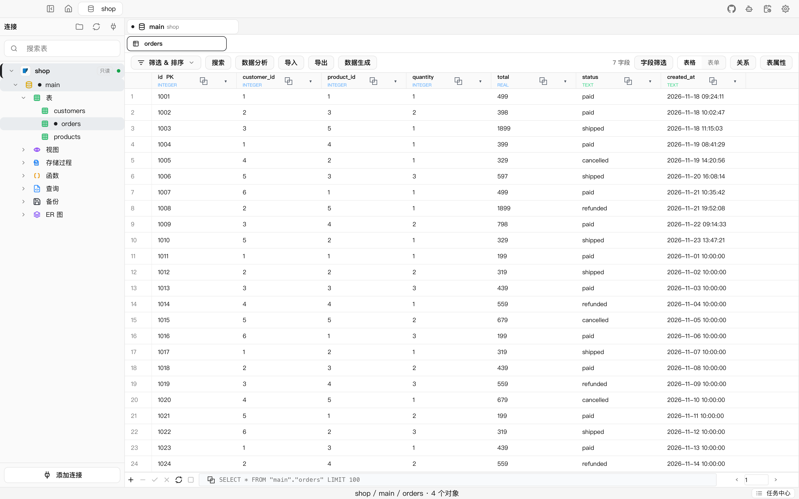
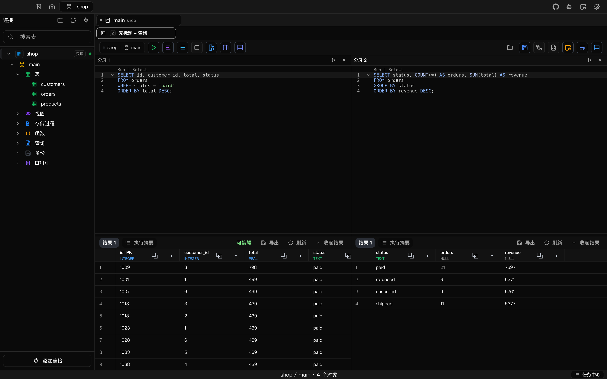
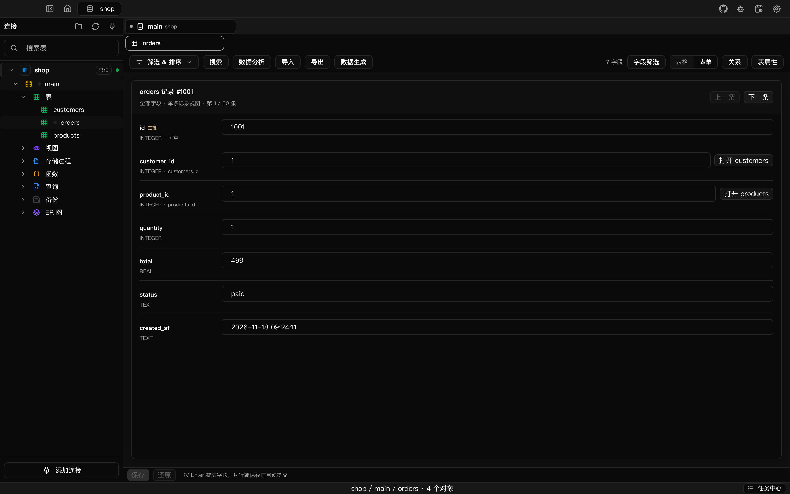
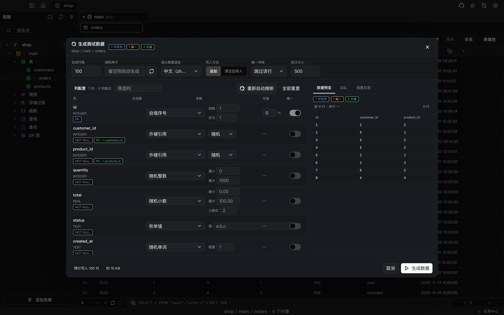

#  FluxDB

**A fast, native database client for people who live in SQL. Rust + GPUI, no Electron, no JVM, no WebView — it opens in about a second, idles at roughly 135 MB, and keeps scrolling a million rows.**

FluxDB puts MySQL, PostgreSQL, SQL Server, Oracle, TiDB, MariaDB, KingbaseES, Dameng DM8, SQLite, MongoDB and Redis in one window: query, edit data, design schemas, compare and sync structures, back up, and debug Redis — with an AI Agent that has explicit, auditable permission boundaries.

**English | [简体中文](./README.zh-CN.md)**

[](https://github.com/fluxdb-alt/fluxDB/releases/latest)
[](https://github.com/fluxdb-alt/fluxDB/actions/workflows/ci.yml)
[](./LICENSE)


[Download](#install) · [Benchmarks](#benchmarks) · [Features](#what-it-does) · [Database support](#database-support) · [User guide](./docs/user-guide.md) · [Report an issue](https://github.com/fluxdb-alt/fluxDB/issues)

<picture>
  <source media="(prefers-color-scheme: dark)" srcset="docs/screenshots/readme-data-grid-dark.png">
  
</picture>

## Why FluxDB

Most database clients are either heavy (Electron, JVM) or paid. FluxDB is neither. It is a single native binary that starts fast, stays small, and covers the work you actually do: write SQL, edit rows, migrate a schema, take a backup before you do something regrettable.

**It is small.** Idle memory is a third of DBeaver's. Scrolling a large table takes less than half the memory of either DBeaver or dbx.

**It is complete.** Structure and data sync across engines, backup/restore, visual table design, ER diagrams, a test-data generator, a MongoDB workbench, a Redis workbench with CLI and Pub/Sub, and an AI Agent that cannot run a destructive statement without your approval.

**It is honest about coverage.** The [database support table](#database-support) lists, per engine, what works, what is partial and what is missing. No marketing asterisks.

## Benchmarks

Measured on the same machine, same PostgreSQL table, same operation. Memory is the median footprint across the phase, sampled roughly every second; scroll is a 25-second continuous scroll over a large result set.

| | FluxDB | dbx | DBeaver |
| --- | --- | --- | --- |
| Idle memory | **135 MB** | 206 MB | 413 MB |
| Query, peak median | **220 MB** | 395 MB | 569 MB |
| Scrolling, median | **271 MB** | 650 MB | 625 MB |
| Scroll frame rate (60 fps target) | **52.6 fps** | 50.5 fps | 43.5 fps |
| Frames dropped while scrolling | **12.3 %** | 15.9 % | 27.5 % |

Raw samples, scripts and the measurement notes are in [`bench-results/`](./bench-results). Your numbers will differ; these are here so you can check them, not so you will believe them.

## What it does

- **Write SQL with an editor that knows your schema.** Completion for keywords, tables, columns and functions, folding, formatting, history, split panes, and a command palette that reaches connections, tables and history.
- **Edit data without writing `UPDATE` by hand.** Paginated browsing, filters, sorting, form view, editable result sets that write back — with confirmation on anything destructive. Follow foreign keys into the related row, and see the ER mini-map.
- **Design and migrate schemas.** Visual table design that emits the target dialect's DDL, structure comparison with chunked previews, and data sync across engines with resumable runs and per-row failure policies.
- **Back up before you break it.** Native `mysqldump` / `pg_dump` / `mongodump` / `VACUUM INTO` paths, plus a built-in consistent-snapshot logical backup with SHA-256 verification when the tools are not installed.
- **Generate test data.** 40+ generators per column, foreign keys drawn from the real parent table, up to 200,000 rows, previewable as data, SQL or a task log.
- **Work with MongoDB and Redis like first-class citizens.** A MongoDB collection workspace (filter, projection, aggregation, indexes) and a Redis workbench with key editing, CLI and Pub/Sub — not a grid bolted onto a SQL client.
- **Let AI help without handing it the keys.** The Agent reads only bounded slices of your schema, edits only the editor range you authorize, and needs approval before `db.run` or `redis.execute`.
- **Stay in your language.** English and Simplified Chinese, switchable at runtime.

### Fewer clicks, less typing

**Two queries, one tab.** Split the editor any number of times; each pane keeps its own text and its own results, so you can compare a detail query against an aggregate without losing your place.



**Read a wide row without scrolling sideways.** Switch to form view to see one record in full, field by field — and follow a foreign key with one click instead of writing a `WHERE`.



**Fill a table without writing INSERTs.** Pick a generator per column, draw foreign keys from the parent table, set the row count, and preview the rows, the SQL or the task log before anything runs.



### Stay on the keyboard

**Open a table without leaving the keyboard.** `⌘P` searches the tables in the current database, highlights the matching characters, and opens the one you pick.


**Completion that knows your schema.** Tables in `JOIN` position, and columns after an alias — typing `o.` lists the real columns of `orders`, with a documentation panel beside the list.


## Install

Pick the package for your platform from the [latest release](https://github.com/fluxdb-alt/fluxDB/releases/latest).

| Platform | Architecture | Package |
| --- | --- | --- |
| macOS | Apple Silicon (ARM64) | `FluxDB-<version>-macos-arm64.dmg` |
| macOS | Intel (x64) | `FluxDB-<version>-macos-x64.dmg` |
| Windows | x64 | `FluxDB-<version>-windows-x64-setup.exe` |
| Linux | x64 | `fluxdb_<version>_amd64.deb` |

- **macOS**: open the DMG and drag FluxDB into Applications. The app is currently ad-hoc signed and not notarized. If macOS blocks the first launch, verify the download source and allow it in System Settings → Privacy & Security.
- **Windows**: run the installer and optionally create a desktop shortcut.
- **Linux**: targets Debian-based distributions such as Ubuntu 22.04/24.04 with X11 or Wayland. Run `sudo apt install ./fluxdb_<version>_amd64.deb`.

Release packages include `.sha256` checksums. Windows ARM64, Linux ARM64, AppImage, Flatpak and Snap are not currently available.

Native backup/restore for MySQL, MariaDB, TiDB, PostgreSQL and MongoDB depends on the local `mysqldump` / `mariadb-dump`, `mysql` / `mariadb`, `pg_dump` / `psql`, `mongodump` / `mongorestore` and `mongosh` clients. The built-in logical SQL backup still works without `mysqldump` / `pg_dump`, and basic queries and editing do not require these tools.

After installation, choose "Add connection", select a database type, enter the connection details and test the connection. See the [user guide](./docs/user-guide.md); it currently uses Chinese screenshots and macOS shortcuts.

## Latest changes

### v0.1.20

- **Structure and data sync**: sync orchestration with chunked previews and streaming execution, cross-dialect table creation and type mapping. Structure sync covers CHECK constraints, foreign-key actions, index types / predicates and generated columns; SQLite can create and drop native indexes. The task center records sync jobs, and the wizard requires an explicit table selection before preview or execution.
- **Migration SQL and resumable data sync**: export migration SQL after each statement succeeds, with table-and-time file names, append mode and no repeated header. Cross-database writes add conflict modes, per-row failure policies and LOB summaries; the sync ledger records resume signatures, chunk cursors and failed rows.
- **Backup and restore**: MongoDB native archive backup / restore (`mongodump` / `mongorestore`) with credentials passed through a temporary 0600 config file; PostgreSQL logical backup; MySQL / PostgreSQL logical backups now use consistent snapshots, keyset pagination and multi-row `INSERT` batches. Restore accepts MongoDB, and backup-list paths can be clicked to copy.
- **Table comments and copy headers**: sidebar table rows show comments on hover, and object search, quick open (`⌘P`) and the command palette match comments. `⌘⇧C` / `Ctrl+Shift+C` copies a selection with column names.
- **Sync completion and UI polish**: dedicated success / partial-failure / cancelled status bars with table and row totals; unified theme-aware database brand tiles; a loading state for structure comparison; the Schema field is hidden for databases where the database is the schema.
- **Fixes**: SQL Server object-tree error 207, MySQL 9.x `mysqldump` rejecting `--connect-timeout`, read-only connections that could not be disabled when edited, stale MySQL table sizes in the sidebar, and Redis JSON display issues (key types changing with value content, long values cut off in the read-only view, and JSON keys silently stored as strings when the RedisJSON module is missing).

[Full release notes](./release-notes/v0.1.20/en.md) · [All releases](https://github.com/fluxdb-alt/fluxDB/releases)

<details>
<summary>Older releases</summary>

### v0.1.19

- **Query result export and select-all**: data pages and query results select every cell with `⌘A` / `Ctrl+A` and copy it as TSV. The query result toolbar gains an export that reuses the SQL actually executed and lets you edit it, with field selection and TXT / CSV / JSON / XML output, reading the full SQL in batches with cancellation.
- **Test data generator**: pick from 40+ generators per column and configure their parameters, with foreign-key columns drawing from a parent-table value pool. Set rows (up to 200,000), seed, data language, NULL rate, unique-conflict policy and append or truncate-then-write, with data, SQL and task-log previews.
- **Query editor split panes**: split a tab horizontally or vertically any number of times, each pane with its own editor, run action and results; closing a pane with content offers to discard it or move it to a new tab.
- **Foreign-key navigation and form view**: a "Table | Form" switch on data pages, equality jumps from foreign-key cells and the right-hand relations panel, inline previews and an ER mini-map.
- **Faster finding and switching**: a unified command palette (`⇧⌘P`), a Ctrl+Tab tab drawer, a searchable tab switcher (`⇧⌘E`), numbered tab access (`⌥1`–`⌥9`) and table shortcut groups that bind one key to several tables.
- **Table sizes in the sidebar**: MySQL / MariaDB / TiDB, PostgreSQL / KingbaseES and SQL Server show table sizes, hidden when the sidebar is narrower than 220 px.
- **Improvements and fixes**: the built-in Flux Amber theme; fixed SQL history loss at startup, history skipping digit-prefixed table names, and history quick search leaking across databases.

[Full release notes](./release-notes/v0.1.19/en.md)

</details>

## Database support

Capabilities vary by database. See the [user guide](./docs/user-guide.md) for details.

| Database | Current capabilities | Backup / restore | Connections and limits | Not yet supported |
| --- | --- | --- | --- | --- |
| MySQL | SQL queries, object browsing, table management, data editing, import/export, native client tool entry | Native `mysqldump`; built-in logical SQL backup on a consistent snapshot with keyset pagination; SQL restore | TLS/SSL, SSH tunnel, proxy, timeouts, charset | - |
| TiDB | Reuses the MySQL protocol path with TiDB SQL dialect, completion and schema management | Reuses MySQL logical backup and restore | Same connection features as MySQL | - |
| MariaDB | Reuses the MySQL protocol path for object browsing, SQL queries, table structure management, data editing, import/export, and users/privileges; detects MariaDB server versions | Native `mysqldump` / `mariadb-dump`; built-in logical SQL backup; SQL restore | Same connection features as MySQL; default port 3306 | - |
| PostgreSQL | SQL queries, schema/object browsing, table management, data editing, users and roles, psql tool entry | Native `pg_dump` plain SQL; built-in logical backup on a repeatable-read snapshot; `psql` restore | TLS, SSH, proxy, schema scope, timeouts | - |
| KingbaseES | Reuses the PostgreSQL connector in PG compatibility mode: connection, database/schema and object browsing, SQL queries, data viewing/editing, table structure viewing/design; the users and privileges page reuses the PostgreSQL implementation and has not been separately regression-tested | Native backup/restore not supported; use `sys_dump` / `ksql` from the command line | PG compatibility mode only; default port 54321, username usually `system`, default database `test`; the same form, TLS/SSH/proxy entry points as PostgreSQL | Oracle compatibility mode, native backup/restore, external `psql` / `ksql` tool entries |
| SQL Server | T-SQL queries, database/schema/object browsing, table design and data editing, table import/export, logins, database users, role membership and explicit permissions, object-level logical backup/restore, AI page context and controlled execution | Object-level logical SQL backup and restore | SQL Server authentication, TLS, explicit ports; named instances require the actual port | Windows integrated authentication, Azure AD, contained database users, column-level permission editing, user-defined server roles, SQL Browser/named-instance auto-discovery, and database-level physical `BACKUP DATABASE`. Object-level logical backup and restore is not a substitute for database-level disaster recovery. |
| SQLite | Local file connections, SQL queries, object browsing, table management, data editing | Consistent `VACUUM INTO` snapshot; restore to a new file with integrity and foreign-key checks | Local file path | - |
| Dameng DM8 | Schema/object browsing, SQL queries, table design and management, data editing, table import | Logical backup and SQL restore; restore currently targets a single schema | Instance and schema connection settings | - |
| Oracle | SQL queries, schema/object browsing, table design and management, data editing, filtering and sorting, SQL completion, users and privileges (read-only grants for the current account), logical export, AI page context and controlled execution | Local logical export (DDL + paged data); restore by replaying SQL | Service Name or SID, CDB/PDB target; unquoted identifiers fold to uppercase | Server-side Data Pump, grants for accounts other than the current one (`DBA_*` / `ALL_SYS_PRIVS` need extra privileges), cross-page consistent snapshot export. Paged export is neither a consistent snapshot nor a server-side native backup. |
| MongoDB | Connection-string import (`mongodb://` / `mongodb+srv://`), database/collection/view browsing, collection workspace (document filter/projection/sort, condition builder, aggregation, indexes, collection info), document create/edit/duplicate/delete, JSON / JSONL / CSV import and export, collection rename and drop, command-line terminal, SQL-style query completion, AI page context and controlled execution | Native `mongodump` / `mongorestore` whole-database archive with `--gzip`; restore can remap to another database when started from a backup record | `mongodb+srv://` discovery, SCRAM-SHA-1 / SCRAM-SHA-256 / MONGODB-X509, TLS options via connection-string import; at most 500 documents per query | No per-collection backup selection, `--oplog` or performance-metrics panel; no SSH tunnel, bulk delete (and no undo), cross-database collection moves, view rename/drop, time-series or capped collection creation, in-table row editing, transactions or change streams. CSV import supports scalar fields only and must be UTF-8; new documents always get an ObjectId `_id`. |
| Redis | Keyspace browsing, value editing, TTL, Workbench, CLI, Pub/Sub | No database-level backup/restore | TLS, SSH, Sentinel, Cluster, URI/Cloud; Cluster uses DB 0 only | - |

## AI Agent

FluxDB includes an optional AI Agent for understanding schemas, writing SQL, investigating data and generating reports. It is not an unrestricted desktop assistant.

- **Schema discovery**: search connections, databases, schemas, tables, views and columns without reading whole tables by default.
- **Bounded reads**: read only the rows or content allowed by each tool contract.
- **Authorized editor actions**: edit only an explicitly authorized SQL range and never execute it implicitly.
- **Controlled SQL and Redis execution**: write or high-risk tools such as `db.run` and `redis.execute` require approval.
- **Scoped context**: read only authorized attachments, page references or editor snapshots.
- **BI and reports**: generate report drafts, charts, tables and explanations as saveable artifacts.
- **MCP and plugins**: configure MCP Client/Server, model bindings, plugins, tool permissions and usage diagnostics.
- **User-provided models**: configure your own model service and API key. Secrets use controlled storage and do not enter ordinary logs, exports or AI context.

**Writes wait for you.** A write tool stops at the approval card: target, the exact statement, risk level and estimated rows. Approve it and the statement runs; deny it and nothing happens. The grid above refreshes with the result.


## Demo

**Full demo** · 2 min 46 sec · MP4, about 8.6 MB

https://github.com/user-attachments/assets/f6075999-a87f-4644-9d14-dbda49a7981d

## Run from source

<details>
<summary>Build dependencies, running and packaging</summary>

### Prerequisites

Install the latest stable [Rust toolchain](https://rustup.rs) (the project uses Rust edition 2024) and the native build tools for your platform:

| Platform | Build dependencies |
| --- | --- |
| macOS | Xcode Command Line Tools, available through `xcode-select --install` |
| Windows | Visual Studio Build Tools with Desktop development with C++ and the Windows SDK, using the MSVC toolchain; release builds require the SDK's `fxc.exe` |
| Linux | C/C++ compiler, pkg-config, CMake, Clang, OpenSSL, font and X11/Wayland development libraries; see the [CI configuration](./.github/workflows/ci.yml) for the complete list |

### Run

```bash
git clone https://github.com/fluxdb-alt/fluxDB.git
cd fluxDB
cargo run --locked -p fluxdb-desktop
```

The first build downloads and compiles dependencies and may take a while.

### Build and package

```bash
cargo build --locked --release -p fluxdb-desktop
```

On macOS, generate an `.app` and `.dmg` containing the required dynamic libraries:

```bash
./scripts/package-macos.sh
```

The script supports options such as `PROFILE=debug` and `CREATE_DMG=0`; see the [packaging script](./scripts/package-macos.sh). Windows installer and Linux DEB steps are defined in the [release workflow](./.github/workflows/release.yml).

</details>

## Contributing

Issues, feature proposals, documentation improvements and code contributions are welcome.

- **Report a bug**: search [existing issues](https://github.com/fluxdb-alt/fluxDB/issues) first, then include the app version, operating system and architecture, database type and version, reproduction steps, expected and actual results, and sanitized logs or screenshots where useful.
- **Suggest a feature**: describe the use case and the problem it solves. Discuss larger changes before implementation.
- **Contribute code**: fork the repository, create a focused branch and explain the reason and validation results in the pull request. See [AGENTS.md](./AGENTS.md) for development conventions and the [UI style guide](./docs/ui-style.md) for interface changes (both in Chinese).

Run the local quality gate before submitting:

```bash
./scripts/check.sh
```

Cross-platform build differences still require CI verification before release.

AI is used extensively in the development workflow. Humans own requirements, review, validation and release approval.

## Roadmap

Current priorities are real-world coverage for existing databases, stability and the cross-platform release experience. Candidate directions include:

- **SQL Server follow-up**: Windows integrated authentication and Azure AD, contained database users, column-level permissions, user-defined server roles, named-instance auto-discovery, and database-level physical backup/restore.
- **MongoDB follow-up**: performance metrics, bulk delete and bulk writes, in-table row editing, transactions and change streams.
- **More databases**: evaluate ClickHouse, DuckDB, Elasticsearch/OpenSearch and others based on community demand.

The roadmap does not imply current support.

## Support and sponsorship

If FluxDB is useful to you, consider starring the repository, sharing it with others, or contributing through issues, documentation and code.

You can also sponsor ongoing development and AI tooling costs.

| Alipay | WeChat |
| :---: | :---: |
|  |  |

## Acknowledgements

- [Zed](https://github.com/zed-industries/zed): GPUI ecosystem, editor and native desktop architecture.
- [GPUI Component / gpui-kit](https://github.com/longbridge/gpui-kit): reusable UI components.
- [dbx](https://github.com/t8y2/dbx): multi-database abstraction and connection-management design reference.
- [RedisInsight](https://github.com/RedisInsight/RedisInsight): Redis visualization and interaction design reference.

## License

FluxDB is licensed under the [GNU GPL v3.0 or later](./LICENSE).

See [NOTICE](./NOTICE) for copyright and attribution details.
