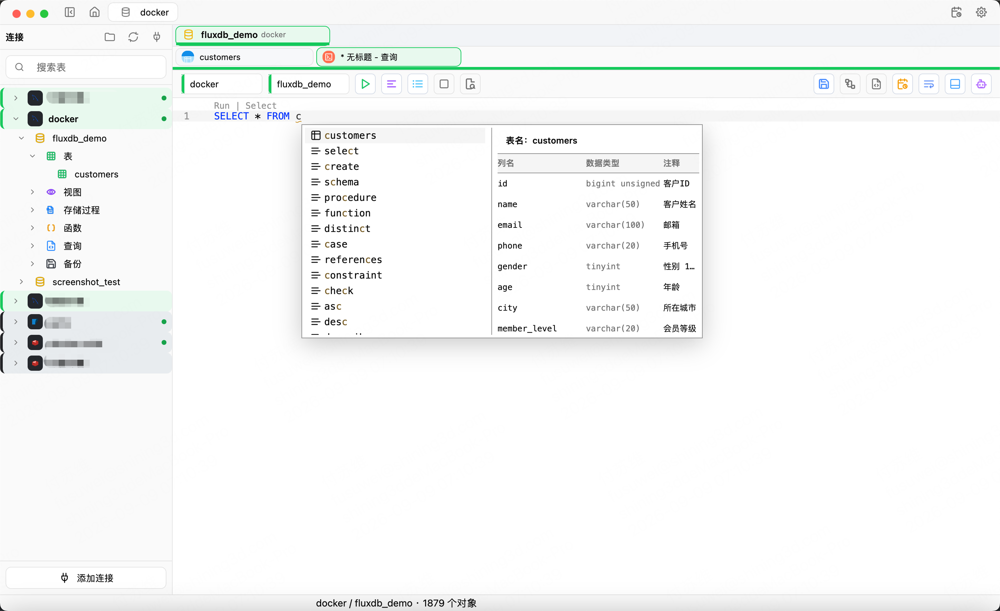

# FluxDB

**A native, cross-platform database client and SQL editor designed for high performance and low overhead: query, edit data, manage schemas and debug Redis in one window.**

FluxDB is built with Rust and GPUI, without Electron or a WebView. It brings MySQL, MariaDB, PostgreSQL, KingbaseES, SQL Server, SQLite, TiDB, Dameng DM8, MongoDB and Redis into one desktop workflow, with a permission-aware AI Agent.

**English | [简体中文](./README.zh-CN.md)**

[](https://github.com/fluxdb-alt/fluxDB/releases/latest)
[](https://github.com/fluxdb-alt/fluxDB/actions/workflows/ci.yml)
[](./LICENSE)


[Download the latest release](https://github.com/fluxdb-alt/fluxDB/releases/latest) · [Latest changes](#latest-changes) · [Features](#core-capabilities) · [Database support](#database-support) · [User guide](./docs/user-guide.md) · [Report an issue](https://github.com/fluxdb-alt/fluxDB/issues)




## Latest changes

### v0.1.20

- **Structure and data sync**: sync orchestration with chunked previews and streaming execution, cross-dialect table creation and type mapping. Structure sync covers CHECK constraints, foreign-key actions, index types / predicates and generated columns; SQLite can create and drop native indexes. The task center records sync jobs, and the wizard requires an explicit table selection before preview or execution.
- **Migration SQL and resumable data sync**: export migration SQL after each statement succeeds, with table-and-time file names, append mode and no repeated header. Cross-database writes add conflict modes, per-row failure policies and LOB summaries; the sync ledger records resume signatures, chunk cursors and failed rows.
- **Backup and restore**: MongoDB native archive backup / restore (`mongodump` / `mongorestore`) with credentials passed through a temporary 0600 config file; PostgreSQL logical backup; MySQL / PostgreSQL logical backups now use consistent snapshots, keyset pagination and multi-row `INSERT` batches. Restore accepts MongoDB, and backup-list paths can be clicked to copy.
- **Table comments and copy headers**: sidebar table rows show comments on hover, and object search, quick open (`⌘P`) and the command palette match comments. `⌘⇧C` / `Ctrl+Shift+C` copies a selection with column names.
- **Sync completion and UI polish**: dedicated success / partial-failure / cancelled status bars with table and row totals; unified theme-aware database brand tiles; a loading state for structure comparison; the Schema field is hidden for databases where the database is the schema.
- **Fixes**: SQL Server object-tree error 207, MySQL 9.x `mysqldump` rejecting `--connect-timeout`, read-only connections that could not be disabled when edited, stale MySQL table sizes in the sidebar, and Redis JSON display issues (key types changing with value content, long values cut off in the read-only view, and JSON keys silently stored as strings when the RedisJSON module is missing).

[Full release notes](./release-notes/v0.1.20/en.md) · [All releases](https://github.com/fluxdb-alt/fluxDB/releases)

### v0.1.19

- **Query result export and select-all**: data pages and query results select every cell with `⌘A` / `Ctrl+A` and copy it as TSV. The query result toolbar gains an export that reuses the SQL actually executed and lets you edit it, with field selection and TXT / CSV / JSON / XML output, reading the full SQL in batches with cancellation.
- **Test data generator**: pick from 40+ generators per column and configure their parameters, with foreign-key columns drawing from a parent-table value pool. Set rows (up to 200,000), seed, data language, NULL rate, unique-conflict policy and append or truncate-then-write, with data, SQL and task-log previews.
- **Query editor split panes**: split a tab horizontally or vertically any number of times, each pane with its own editor, run action and results; closing a pane with content offers to discard it or move it to a new tab.
- **Foreign-key navigation and form view**: a "Table | Form" switch on data pages, equality jumps from foreign-key cells and the right-hand relations panel, inline previews and an ER mini-map.
- **Faster finding and switching**: a unified command palette (`⇧⌘P`), a Ctrl+Tab tab drawer, a searchable tab switcher (`⇧⌘E`), numbered tab access (`⌥1`–`⌥9`) and table shortcut groups that bind one key to several tables.
- **Table sizes in the sidebar**: MySQL / MariaDB / TiDB, PostgreSQL / KingbaseES and SQL Server show table sizes, hidden when the sidebar is narrower than 220 px.
- **Improvements and fixes**: the built-in Flux Amber theme; fixed SQL history loss at startup, history skipping digit-prefixed table names, and history quick search leaking across databases.

[Full release notes](./release-notes/v0.1.19/en.md) · [All releases](https://github.com/fluxdb-alt/fluxDB/releases)

## Why FluxDB

- **One workspace for multiple data sources**: manage relational databases, MongoDB and Redis side by side.
- **From query to write**: SQL editing, editable result sets, table design, import/export, backup/restore and ER diagrams.
- **Native architecture, performance first**: built with Rust + GPUI, without Electron or a WebView, with low overhead and responsive interaction as design goals.
- **AI with explicit boundaries**: bounded reads, authorized editor edits and approval for write or high-risk tools.

## Core capabilities

### SQL and data

- Syntax highlighting, code folding, keyword/table/column/function completion, SQL formatting and query history.
- Paginated browsing, filters, sorting, row details and cell details.
- Editable result sets with writes back to the database and safeguards for dangerous actions.
- Import TXT, CSV, JSON and XML.
- Export SQL, TXT, CSV, JSON and XML.
- Execute existing `.sql` files.

### Schema and ER diagrams

- Inspect columns, indexes, foreign keys, triggers and DDL.
- Create and modify tables visually, with DDL generated for the target database dialect.
- Layout ER diagrams from real foreign keys, with optional local logical relationships.
- Local logical relationships never create or modify database foreign keys.
- Export ER diagrams as JSON, DBML, Mermaid or SVG.

### Backup and restore

- Native tool paths for MySQL / MariaDB / TiDB (`mysqldump`), PostgreSQL (`pg_dump`), MongoDB (`mongodump`) and SQLite (`VACUUM INTO`), plus a built-in logical SQL fallback when dump tools are missing.
- Logical backups use consistent snapshots where supported, keyset pagination and batched `INSERT`s; restores can target another database and verify the data-part SHA-256 and row counts when the manifest provides them.
- The backup list keeps table manifests, restore history and notes, and paths can be copied with one click.

### MongoDB workbench

- Connection-string import with SRV discovery, browsing by database / collection / view, and connection info with topology.
- The documents tab supports filter, projection, sort, collation, paging and index hint, with card, table and JSON display modes.
- The condition builder and completion cover filter, projection, sort and aggregation pipelines; aggregation, indexes and collection info each have their own tab.
- Create, edit, duplicate and delete documents; import JSON / JSONL / CSV and export JSON / JSONL / CSV.
- Collection context menu covers pin, copy name, refresh, export, rename, import and drop; databases can create collections and be dropped.

### Redis workbench

- Browse the keyspace and inspect or edit common value types, TTL and key details.
- Run commands with command history in the Workbench.
- Use the embedded Redis CLI terminal.
- Observe channel messages with Pub/Sub subscriptions.
- Connect with TLS, SSH tunnels, Sentinel, Cluster, URI or Cloud configuration.

### Operations, security and updates

- Connection passwords and model API keys use controlled storage and stay out of ordinary exports, logs, event snapshots and AI context.
- In-app updates verify the signed manifest and package checksum.
- Release packages include SHA-256 checksums.
- The UI supports English and Simplified Chinese with runtime switching.

## Demo

**Full demo** · 2 min 46 sec · MP4, about 8.6 MB

https://github.com/user-attachments/assets/f6075999-a87f-4644-9d14-dbda49a7981d

## Database support

Capabilities vary by database. See the [user guide](./docs/user-guide.md) for details.

| Database | Current capabilities | Backup / restore | Connections and limits | Not yet supported |
| --- | --- | --- | --- | --- |
| MySQL | SQL queries, object browsing, table management, data editing, import/export, native client tool entry | Native `mysqldump`; built-in logical SQL backup on a consistent snapshot with keyset pagination; SQL restore | TLS/SSL, SSH tunnel, proxy, timeouts, charset | - |
| TiDB | Reuses the MySQL protocol path with TiDB SQL dialect, completion and schema management | Reuses MySQL logical backup and restore | Same connection features as MySQL | - |
| MariaDB | Reuses the MySQL protocol path for object browsing, SQL queries, table structure management, data editing, import/export, and users/privileges; detects MariaDB server versions | Native `mysqldump` / `mariadb-dump`; built-in logical SQL backup; SQL restore | Same connection features as MySQL; default port 3306 | - |
| PostgreSQL | SQL queries, schema/object browsing, table management, data editing, users and roles, psql tool entry | Native `pg_dump` plain SQL; built-in logical backup on a repeatable-read snapshot; `psql` restore | TLS, SSH, proxy, schema scope, timeouts | - |
| KingbaseES | Reuses the PostgreSQL connector in PG compatibility mode: connection, database/schema and object browsing, SQL queries, data viewing/editing, table structure viewing/design; the users and privileges page reuses the PostgreSQL implementation and has not been separately regression-tested | Native backup/restore not supported; use `sys_dump` / `ksql` from the command line | PG compatibility mode only; default port 54321, username usually `system`, default database `test`; the same form, TLS/SSH/proxy entry points as PostgreSQL | Oracle compatibility mode, native backup/restore, external `psql` / `ksql` tool entries |
| SQL Server | T-SQL queries, database/schema/object browsing, table design and data editing, table import/export, logins, database users, role membership and explicit permissions, object-level logical backup/restore, AI page context and controlled execution | Object-level logical SQL backup and restore | SQL Server authentication, TLS, explicit ports; named instances require the actual port | Windows integrated authentication, Azure AD, contained database users, column-level permission editing, user-defined server roles, SQL Browser/named-instance auto-discovery, and database-level physical `BACKUP DATABASE`. Object-level logical backup and restore is not a substitute for database-level disaster recovery. |
| SQLite | Local file connections, SQL queries, object browsing, table management, data editing | Consistent `VACUUM INTO` snapshot; restore to a new file with integrity and foreign-key checks | Local file path | - |
| Dameng DM8 | Schema/object browsing, SQL queries, table design and management, data editing, table import | Logical backup and SQL restore; restore currently targets a single schema | Instance and schema connection settings | - |
| Oracle | SQL queries, schema/object browsing, table design and management, data editing, filtering and sorting, SQL completion, users and privileges (read-only grants for the current account), logical export, AI page context and controlled execution | Local logical export (DDL + paged data); restore by replaying SQL | Service Name or SID, CDB/PDB target; unquoted identifiers fold to uppercase | Server-side Data Pump, grants for accounts other than the current one (`DBA_*` / `ALL_SYS_PRIVS` need extra privileges), cross-page consistent snapshot export. Paged export is neither a consistent snapshot nor a server-side native backup. |
| MongoDB | Connection-string import (`mongodb://` / `mongodb+srv://`), database/collection/view browsing, collection workspace (document filter/projection/sort, condition builder, aggregation, indexes, collection info), document create/edit/duplicate/delete, JSON / JSONL / CSV import and export, collection rename and drop, command-line terminal, SQL-style query completion, AI page context and controlled execution | Native `mongodump` / `mongorestore` whole-database archive with `--gzip`; restore can remap to another database when started from a backup record | `mongodb+srv://` discovery, SCRAM-SHA-1 / SCRAM-SHA-256 / MONGODB-X509, TLS options via connection-string import; at most 500 documents per query | No per-collection backup selection, `--oplog` or performance-metrics panel; no SSH tunnel, bulk delete (and no undo), cross-database collection moves, view rename/drop, time-series or capped collection creation, in-table row editing, transactions or change streams. CSV import supports scalar fields only and must be UTF-8; new documents always get an ObjectId `_id`. |
| Redis | Keyspace browsing, value editing, TTL, Workbench, CLI, Pub/Sub | No database-level backup/restore | TLS, SSH, Sentinel, Cluster, URI/Cloud; Cluster uses DB 0 only | - |

## AI Agent

FluxDB includes an optional AI Agent for understanding schemas, writing SQL, investigating data and generating reports. It is not an unrestricted desktop assistant.

- **Schema discovery**: search connections, databases, schemas, tables, views and columns without reading whole tables by default.
- **Bounded reads**: read only the rows or content allowed by each tool contract.
- **Authorized editor actions**: edit only an explicitly authorized SQL range and never execute it implicitly.
- **Controlled SQL and Redis execution**: write or high-risk tools such as `db.run` and `redis.execute` require approval.
- **Scoped context**: read only authorized attachments, page references or editor snapshots.
- **BI and reports**: generate report drafts, charts, tables and explanations as saveable artifacts.
- **MCP and plugins**: configure MCP Client/Server, model bindings, plugins, tool permissions and usage diagnostics.
- **User-provided models**: configure your own model service and API key. Secrets use controlled storage and do not enter ordinary logs, exports or AI context.

## Download and install

Open the [latest release](https://github.com/fluxdb-alt/fluxDB/releases/latest) and choose the package for your platform.

| Platform | Architecture | Package |
| --- | --- | --- |
| macOS | Apple Silicon (ARM64) | `FluxDB-<version>-macos-arm64.dmg` |
| macOS | Intel (x64) | `FluxDB-<version>-macos-x64.dmg` |
| Windows | x64 | `FluxDB-<version>-windows-x64-setup.exe` |
| Linux | x64 | `fluxdb_<version>_amd64.deb` |

- **macOS**: open the DMG and drag FluxDB into Applications. The app is currently ad-hoc signed and not notarized. If macOS blocks the first launch, verify the download source and allow it in System Settings → Privacy & Security.
- **Windows**: run the installer and optionally create a desktop shortcut.
- **Linux**: targets Debian-based distributions such as Ubuntu 22.04/24.04 with X11 or Wayland. Run `sudo apt install ./fluxdb_<version>_amd64.deb`.

Release packages include `.sha256` checksums. Windows ARM64, Linux ARM64, AppImage, Flatpak and Snap are not currently available.

Native backup/restore for MySQL, MariaDB, TiDB, PostgreSQL and MongoDB depends on the local `mysqldump` / `mariadb-dump`, `mysql` / `mariadb`, `pg_dump` / `psql`, `mongodump` / `mongorestore` and `mongosh` clients. The built-in logical SQL backup still works without `mysqldump` / `pg_dump`, and basic queries and editing do not require these tools.

After installation, choose “Add connection”, select a database type, enter the connection details and test the connection. See the [user guide](./docs/user-guide.md); it currently uses Chinese screenshots and macOS shortcuts.

## Run from source

<details>
<summary>Build dependencies, running and packaging</summary>

### Prerequisites

Install the latest stable [Rust toolchain](https://rustup.rs) (the project uses Rust edition 2024) and the native build tools for your platform:

| Platform | Build dependencies |
| --- | --- |
| macOS | Xcode Command Line Tools, available through `xcode-select --install` |
| Windows | Visual Studio Build Tools with Desktop development with C++ and the Windows SDK, using the MSVC toolchain; release builds require the SDK's `fxc.exe` |
| Linux | C/C++ compiler, pkg-config, CMake, Clang, OpenSSL, font and X11/Wayland development libraries; see the [CI configuration](./.github/workflows/ci.yml) for the complete list |

### Run

```bash
git clone https://github.com/fluxdb-alt/fluxDB.git
cd fluxDB
cargo run --locked -p fluxdb-desktop
```

The first build downloads and compiles dependencies and may take a while.

### Build and package

```bash
cargo build --locked --release -p fluxdb-desktop
```

On macOS, generate an `.app` and `.dmg` containing the required dynamic libraries:

```bash
./scripts/package-macos.sh
```

The script supports options such as `PROFILE=debug` and `CREATE_DMG=0`; see the [packaging script](./scripts/package-macos.sh). Windows installer and Linux DEB steps are defined in the [release workflow](./.github/workflows/release.yml).

</details>

## Contributing

Issues, feature proposals, documentation improvements and code contributions are welcome.

- **Report a bug**: search [existing issues](https://github.com/fluxdb-alt/fluxDB/issues) first, then include the app version, operating system and architecture, database type and version, reproduction steps, expected and actual results, and sanitized logs or screenshots where useful.
- **Suggest a feature**: describe the use case and the problem it solves. Discuss larger changes before implementation.
- **Contribute code**: fork the repository, create a focused branch and explain the reason and validation results in the pull request. See [AGENTS.md](./AGENTS.md) for development conventions and the [UI style guide](./docs/ui-style.md) for interface changes (both in Chinese).

Run the local quality gate before submitting:

```bash
./scripts/check.sh
```

Cross-platform build differences still require CI verification before release.

AI is used extensively in the development workflow. Humans own requirements, review, validation and release approval.

## Roadmap

Current priorities are real-world coverage for existing databases, stability and the cross-platform release experience. Candidate directions include:

- **SQL Server follow-up**: Windows integrated authentication and Azure AD, contained database users, column-level permissions, user-defined server roles, named-instance auto-discovery, and database-level physical backup/restore.
- **MongoDB follow-up**: performance metrics, bulk delete and bulk writes, in-table row editing, transactions and change streams.
- **More databases**: evaluate ClickHouse, DuckDB, Elasticsearch/OpenSearch and others based on community demand.

The roadmap does not imply current support.

## Support and sponsorship

If FluxDB is useful to you, consider starring the repository, sharing it with others, or contributing through issues, documentation and code.

You can also sponsor ongoing development and AI tooling costs.

| Alipay | WeChat |
| :---: | :---: |
|  |  |

## Acknowledgements

- [Zed](https://github.com/zed-industries/zed): GPUI ecosystem, editor and native desktop architecture.
- [GPUI Component / gpui-kit](https://github.com/longbridge/gpui-kit): reusable UI components.
- [dbx](https://github.com/t8y2/dbx): multi-database abstraction and connection-management design reference.
- [RedisInsight](https://github.com/RedisInsight/RedisInsight): Redis visualization and interaction design reference.

## License

FluxDB is licensed under the [GNU GPL v3.0 or later](./LICENSE).

See [NOTICE](./NOTICE) for copyright and attribution details.
