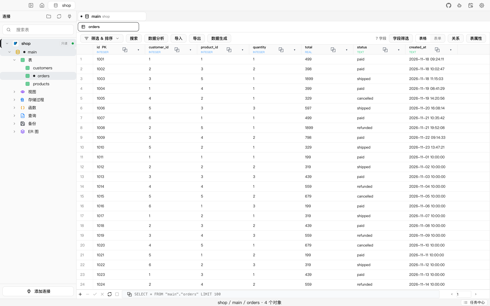
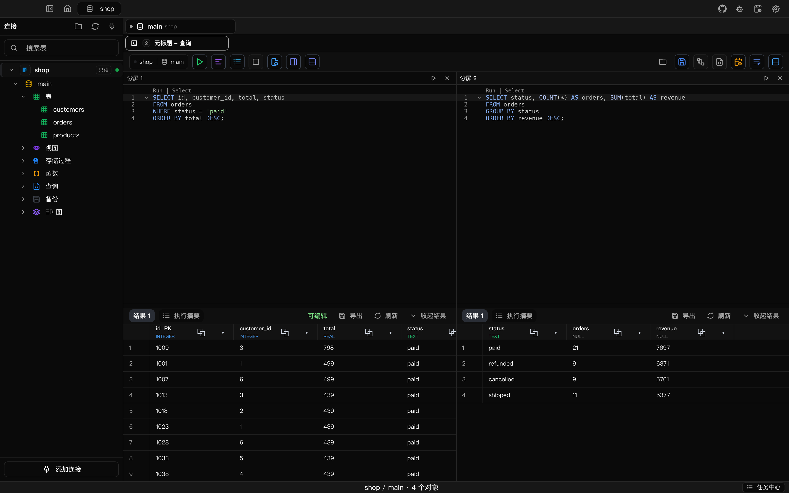
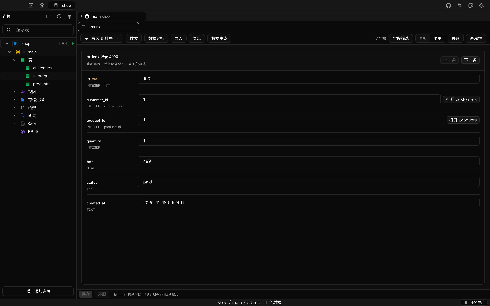
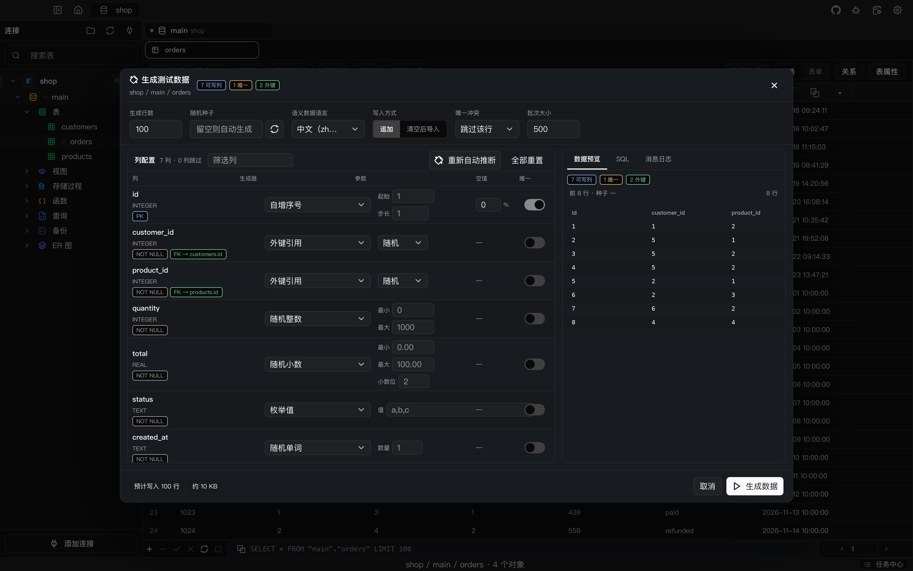

#  FluxDB

**一个为真正写 SQL 的人做的、快速的原生数据库客户端。Rust + GPUI，不用 Electron、不用 JVM、不用 WebView —— 秒开，空载约 135 MB，百万行照样滚得动。**

FluxDB 把 MySQL、PostgreSQL、SQL Server、Oracle、TiDB、MariaDB、人大金仓 KingbaseES、达梦 DM8、SQLite、MongoDB 和 Redis 放进同一个窗口：查询、编辑数据、设计结构、比对与同步、备份，以及调试 Redis —— 并且带一个权限边界明确、可审计的 AI Agent。

**简体中文 | [English](./README.md)**

[](https://github.com/fluxdb-alt/fluxDB/releases/latest)
[](https://github.com/fluxdb-alt/fluxDB/actions/workflows/ci.yml)
[](./LICENSE)


[下载](#安装) · [性能对比](#性能对比) · [功能一览](#功能一览) · [数据库支持](#数据库支持) · [操作手册](./docs/user-guide.md) · [反馈问题](https://github.com/fluxdb-alt/fluxDB/issues)

<picture>
  <source media="(prefers-color-scheme: dark)" srcset="docs/screenshots/readme-data-grid-dark.png">
  
</picture>

## 为什么选择 FluxDB

大多数数据库客户端要么很重（Electron、JVM），要么收费。FluxDB 两样都不是。它是一个单体的原生二进制，启动快、常驻小，并且覆盖你真正要做的事：写 SQL、改数据、迁移结构、在干出后悔的事之前先备份。

**它很小。** 空载内存是 DBeaver 的三分之一；滚动大表时的内存不到 DBeaver 和 dbx 的一半。

**它很全。** 跨引擎的结构与数据同步、备份恢复、可视化表设计、ER 图、测试数据生成、MongoDB 工作台、带 CLI 和 Pub/Sub 的 Redis 工作台，以及一个不经你批准就无法执行破坏性语句的 AI Agent。

**它对覆盖范围很诚实。** [数据库支持表](#数据库支持) 按引擎逐项列出哪些可用、哪些部分可用、哪些还没有。没有营销星号。

## 性能对比

同一台机器、同一张 PostgreSQL 表、同一个操作。内存为该阶段的中位占用，约每秒采样一次；滚动为大结果集上的 25 秒连续滚动。

| | FluxDB | dbx | DBeaver |
| --- | --- | --- | --- |
| 空载内存 | **135 MB** | 206 MB | 413 MB |
| 查询阶段中位峰值 | **220 MB** | 395 MB | 569 MB |
| 滚动阶段中位内存 | **271 MB** | 650 MB | 625 MB |
| 滚动帧率（目标 60 fps） | **52.6 fps** | 50.5 fps | 43.5 fps |
| 滚动丢帧率 | **12.3 %** | 15.9 % | 27.5 % |

原始采样、脚本与测量说明见 [`bench-results/`](./bench-results)。你的数字会不一样；把它们放在这里是让你可以复核，而不是让你直接相信。

## 功能一览

- **用一个懂你 schema 的编辑器写 SQL。** 关键字、表、列、函数补全，折叠、格式化、历史、分屏，以及一个能搜到连接、表和历史的命令面板。
- **不手写 `UPDATE` 也能改数据。** 分页浏览、筛选、排序、表单视图、可编辑并回写的结果集 —— 危险操作一律确认。顺着外键跳到关联行，旁边就是 ER 迷你图。
- **设计并迁移结构。** 可视化表设计直接产出目标方言的 DDL，结构比对带分块预览，跨引擎数据同步支持断点续传和行级失败策略。
- **先把备份做了。** 原生 `mysqldump` / `pg_dump` / `mongodump` / `VACUUM INTO`，工具没装时还有内置的一致性快照逻辑备份，带 SHA-256 校验。
- **造测试数据。** 每列 40+ 生成器，外键从真实父表取值，最多 20 万行，可预览数据、SQL 或任务日志。
- **MongoDB 和 Redis 是一等公民。** MongoDB 集合工作台（筛选、投影、聚合、索引）和带键编辑、CLI、Pub/Sub 的 Redis 工作台 —— 不是在 SQL 客户端上钉一个表格。
- **让 AI 帮忙，但别把钥匙给它。** Agent 只读取有界的 schema 切片，只改你授权的编辑器范围，执行 `db.run` 或 `redis.execute` 前必须审批。
- **用你的语言。** 简体中文与英文，运行时切换。

### 少点几下，少敲几行

**一个标签，两条查询。** 编辑器可任意分屏，每屏保留自己的文本和结果：拿明细 SQL 对照聚合 SQL，不用来回切标签。



**看宽表不用横向拖。** 切到表单视图逐字段看完整一行；外键字段直接点「打开」，省掉一次手写 `WHERE`。



**造测试数据不用写 INSERT。** 按列选生成器、外键从父表取值、设定行数，执行前可预览数据、SQL 或任务日志。



### 手不离键盘

**手不离键盘也能打开表。** `⌘P` 在当前库里搜索表名，命中字符高亮，回车直接打开。


**补全懂你的 schema。** `JOIN` 位置补表名，别名之后补列 —— 输入 `o.` 就列出 `orders` 的真实字段，右侧同步显示表结构文档。


## 安装

从[最新版本](https://github.com/fluxdb-alt/fluxDB/releases/latest)选择对应平台的包。

| 平台 | 架构 | 安装包 |
| --- | --- | --- |
| macOS | Apple Silicon (ARM64) | `FluxDB-<version>-macos-arm64.dmg` |
| macOS | Intel (x64) | `FluxDB-<version>-macos-x64.dmg` |
| Windows | x64 | `FluxDB-<version>-windows-x64-setup.exe` |
| Linux | x64 | `fluxdb_<version>_amd64.deb` |

- **macOS**：打开 DMG，把 FluxDB 拖进「应用程序」。当前为 ad-hoc 签名、未公证；若 macOS 拦截首次启动，请确认下载来源后到「系统设置 → 隐私与安全性」放行。
- **Windows**：运行安装器，可选创建桌面快捷方式。
- **Linux**：面向 Ubuntu 22.04/24.04 等 Debian 系发行版，支持 X11 与 Wayland。执行 `sudo apt install ./fluxdb_<version>_amd64.deb`。

发布包附带 `.sha256` 校验文件。暂不提供 Windows ARM64、Linux ARM64、AppImage、Flatpak 与 Snap。

MySQL、MariaDB、TiDB、PostgreSQL 和 MongoDB 的原生备份 / 恢复依赖本机的 `mysqldump` / `mariadb-dump`、`mysql` / `mariadb`、`pg_dump` / `psql`、`mongodump` / `mongorestore` 与 `mongosh`。没有 `mysqldump` / `pg_dump` 时内置逻辑 SQL 备份仍可用；基础查询和编辑不依赖这些工具。

安装后选择「添加连接」，选数据库类型，填写连接信息并测试。详见[操作手册](./docs/user-guide.md)，目前手册为中文截图和 macOS 快捷键。

## 最近更新

### v0.1.20

- **结构同步与数据同步**：新增同步编排、分块预览与流式执行，支持跨类型建表与类型映射；结构同步覆盖 CHECK 约束、外键引用动作、索引类型 / predicate 与生成列，SQLite 支持原生索引建删。任务中心记录同步任务，向导在预览或执行前必须显式选择表。
- **迁移 SQL 与断点续传**：数据同步可导出迁移 SQL，语句执行成功后才追加落盘，默认文件名带表名与本地时间，追加模式不重复文件头；跨库写入补齐冲突模式、行级失败策略与 LOB 摘要，同步账本记录续传签名、块游标与失败行。
- **备份与恢复**：新增 MongoDB 原生归档备份 / 恢复（`mongodump` / `mongorestore`），凭据经临时 0600 配置文件传递；新增 PostgreSQL 逻辑备份；MySQL / PostgreSQL 逻辑备份改为一致性快照、keyset 分页与多行 `INSERT` 批量写入。恢复弹框支持 MongoDB，备份列表路径可点击复制。
- **表注释与复制列名**：侧边栏表行悬停显示表注释，对象搜索、快速打开（`⌘P`）与命令面板均可按注释匹配；`⌘⇧C` / `Ctrl+Shift+C` 支持复制选区并附带列名。
- **同步完成状态与界面打磨**：新增成功 / 部分失败 / 已取消状态条与表数、行数统计；统一跟随主题的数据库品牌图标底板；结构对比增加加载态；库即 Schema 的数据库隐藏 Schema 字段。
- **修复**：SQL Server 展开对象树报 207、MySQL 9.x `mysqldump` 拒绝 `--connect-timeout`、编辑连接无法关闭只读、MySQL 侧边栏表体积显示旧值；Redis 键类型随值内容变化、JSON 查看态长值被截断、服务端无 RedisJSON 时选 JSON 创建被静默存成 string。

[完整更新说明](./release-notes/v0.1.20/zh-CN.md) · [历史版本](https://github.com/fluxdb-alt/fluxDB/releases)

<details>
<summary>更早的版本</summary>

### v0.1.19

- **查询结果导出与全选复制**：数据页和查询结果页支持 `⌘A` / `Ctrl+A` 全选当前页单元格并按 TSV 复制；查询结果工具栏新增导出，条件沿用实际执行的 SQL 且可编辑，支持字段选择与 TXT / CSV / JSON / XML，按全量 SQL 分批读取、可取消。
- **测试数据生成**：按列选择 40+ 生成器并配置参数，外键读取父表取值池，支持行数（上限 20 万）、随机种子、数据语言、NULL 比例、唯一冲突策略与追加 / 清空后写入，提供数据、SQL 与任务日志预览。
- **查询编辑器分屏**：标签内可任意左右 / 上下分屏，每屏独立编辑、运行与结果；关闭有内容的分屏可选择丢弃或移到新标签。
- **外键导航与表单视图**：数据页新增「表格 | 表单」切换，外键单元格和右侧关系面板可等值跳转，面板含内联预览与 ER 迷你图。
- **查找与切换增强**：新增统一命令面板（`⇧⌘P`）、标签抽屉切换（`Ctrl+Tab`）、可搜索标签切换器（`⇧⌘E`）、标签编号直达（`⌥1`–`⌥9`）与一个快捷键绑定多张表的表快捷组。
- **侧边栏表大小**：MySQL / MariaDB / TiDB、PostgreSQL / KingbaseES 与 SQL Server 在侧边栏显示表占用大小，宽度不足 220px 时自动隐藏。
- **改进与修复**：新增 Flux Amber 内置主题；修复启动时 SQL 历史丢失、数字开头表名漏记历史与历史快捷搜索跨库的问题。

[完整更新说明](./release-notes/v0.1.19/zh-CN.md)

</details>

## 数据库支持

各数据库的能力范围不同，具体操作见[操作手册](./docs/user-guide.md)。

| 数据库 | 当前能力 | 备份 / 恢复 | 连接与限制 | 尚未支持 |
| --- | --- | --- | --- | --- |
| MySQL | SQL 查询、对象浏览、表结构管理、数据编辑、导入导出、原生客户端工具入口 | 原生 `mysqldump`；内置逻辑 SQL 备份（一致性快照 + keyset 分页）；SQL 恢复 | TLS / SSL、SSH 隧道、代理、超时、字符集 | - |
| TiDB | 复用 MySQL 协议链路，适配 SQL 方言、补全与表结构管理 | 复用 MySQL 逻辑备份与恢复 | 连接能力与 MySQL 一致 | - |
| MariaDB | 复用 MySQL 协议链路，支持对象浏览、SQL 查询、表结构管理、数据编辑、导入导出与用户权限；识别 MariaDB 服务端版本 | 原生 `mysqldump` / `mariadb-dump`；内置逻辑 SQL 备份；SQL 恢复 | 连接能力与 MySQL 一致；默认端口 3306 | - |
| PostgreSQL | SQL 查询、schema / 对象浏览、表结构管理、数据编辑、用户与角色、psql 工具入口 | 原生 `pg_dump` 纯 SQL；内置逻辑备份（可重复读快照）；`psql` 恢复 | TLS、SSH、代理、schema 范围、超时 | - |
| KingbaseES | 复用 PostgreSQL 连接器（PG 兼容模式）：连接、库 / schema / 对象浏览、SQL 查询、数据查看与编辑、表结构查看与设计；用户与权限页复用 PostgreSQL 实现，未单独回归测试 | 不支持原生备份恢复；请使用命令行 `sys_dump` / `ksql` | 仅 PG 兼容模式；默认端口 54321，用户名通常为 `system`，默认库 `test`；连接表单、TLS / SSH / 代理入口与 PostgreSQL 相同 | Oracle 兼容模式、原生备份恢复、外部 `psql` / `ksql` 工具入口 |
| SQL Server | T-SQL 查询、库 / schema / 对象浏览、表设计与数据编辑、表导入导出、登录名、数据库用户、角色成员与显式权限、对象级逻辑备份恢复、AI 页面上下文与受控执行 | 对象级逻辑 SQL 备份与恢复 | SQL Server 认证、TLS、显式端口；命名实例需填写实际端口 | Windows 集成认证、Azure AD、包含数据库用户、列级权限编辑、用户自定义服务器角色、SQL Browser / 命名实例自动发现，以及数据库级物理 `BACKUP DATABASE`。对象级逻辑备份恢复不能替代数据库级容灾。 |
| SQLite | 本地文件连接、SQL 查询、对象浏览、表结构管理、数据编辑 | 一致性 `VACUUM INTO` 快照；恢复到新文件并做完整性与外键检查 | 本地文件路径 | - |
| 达梦 DM8 | schema / 对象浏览、SQL 查询、表设计与管理、数据编辑、表导入 | 逻辑备份与 SQL 恢复；恢复目前只针对单个 schema | 实例与 schema 连接设置 | - |
| Oracle | SQL 查询、schema / 对象浏览、表设计与管理、数据编辑、筛选与排序、SQL 补全、用户与权限（当前账号的只读授权）、逻辑导出、AI 页面上下文与受控执行 | 本地逻辑导出（DDL + 分页数据）；回放 SQL 恢复 | Service Name 或 SID、CDB / PDB 目标；未加引号的标识符统一转大写 | 服务端 Data Pump、为当前账号以外的账号授权（`DBA_*` / `ALL_SYS_PRIVS` 需额外权限）、跨页一致性快照导出。分页导出既不是一致性快照也不是服务端原生备份。 |
| MongoDB | 连接串导入（`mongodb://` / `mongodb+srv://`）、库 / 集合 / 视图浏览、集合工作台（文档筛选 / 投影 / 排序、条件构建器、聚合、索引、集合信息）、文档增删改复制、JSON / JSONL / CSV 导入导出、集合重命名与删除、命令行终端、SQL 风格查询补全、AI 页面上下文与受控执行 | 原生 `mongodump` / `mongorestore` 整库归档（`--gzip`）；从备份记录发起恢复时可重映射到其他库 | `mongodb+srv://` 发现、SCRAM-SHA-1 / SCRAM-SHA-256 / MONGODB-X509、通过连接串导入 TLS 选项；单次查询最多 500 条文档 | 不支持按集合选择备份、`--oplog` 或性能指标面板；不支持 SSH 隧道、批量删除（且无撤销）、跨库集合移动、视图重命名 / 删除、时间序列或固定集合创建、表格行内编辑、事务与变更流。CSV 导入仅支持标量字段且必须为 UTF-8；新文档始终生成 ObjectId `_id`。 |
| Redis | 键空间浏览、值编辑、TTL、工作台、CLI、Pub/Sub | 无库级备份恢复 | TLS、SSH、Sentinel、Cluster、URI / Cloud；Cluster 仅使用 DB 0 | - |

## AI Agent

FluxDB 内置可选的 AI Agent，用于理解 schema、编写 SQL、排查数据和生成报告。它不是不受限制的桌面助手。

- **schema 发现**：搜索连接、库、schema、表、视图和列，默认不整表读取。
- **有界读取**：只读取各工具契约允许的行或内容。
- **授权的编辑器操作**：只修改明确授权的 SQL 范围，且绝不隐式执行。
- **受控的 SQL 与 Redis 执行**：`db.run`、`redis.execute` 等写入或高风险工具需要审批。
- **限定上下文**：只读取已授权的附件、页面引用或编辑器快照。
- **BI 与报告**：生成可保存的报告草稿、图表、表格与说明。
- **MCP 与插件**：配置 MCP Client / Server、模型绑定、插件、工具权限与用量诊断。
- **自带模型**：配置你自己的模型服务与 API Key。密钥走受控存储，不进入普通日志、导出或 AI 上下文。

**写操作先等你点头。** 写入类工具会停在审批卡：目标、完整语句、风险等级和预计影响行数。批准后才执行，拒绝则什么都不会发生；执行完左侧网格同步刷新。


## 演示

**完整演示** · 2 分 46 秒 · MP4，约 8.6 MB

https://github.com/user-attachments/assets/f6075999-a87f-4644-9d14-dbda49a7981d

## 从源码运行

<details>
<summary>构建依赖、运行与打包</summary>

### 前置条件

安装最新稳定版 [Rust 工具链](https://rustup.rs)（项目使用 Rust edition 2024），以及对应平台的原生构建工具：

| 平台 | 构建依赖 |
| --- | --- |
| macOS | Xcode Command Line Tools，可通过 `xcode-select --install` 安装 |
| Windows | Visual Studio Build Tools（含「使用 C++ 的桌面开发」与 Windows SDK），使用 MSVC 工具链；发布构建需要 SDK 的 `fxc.exe` |
| Linux | C / C++ 编译器、pkg-config、CMake、Clang、OpenSSL、字体与 X11 / Wayland 开发库；完整列表见 [CI 配置](./.github/workflows/ci.yml) |

### 运行

```bash
git clone https://github.com/fluxdb-alt/fluxDB.git
cd fluxDB
cargo run --locked -p fluxdb-desktop
```

首次构建会下载并编译依赖，可能耗时较久。

### 构建与打包

```bash
cargo build --locked --release -p fluxdb-desktop
```

在 macOS 上生成包含所需动态库的 `.app` 与 `.dmg`：

```bash
./scripts/package-macos.sh
```

脚本支持 `PROFILE=debug`、`CREATE_DMG=0` 等选项；详见[打包脚本](./scripts/package-macos.sh)。Windows 安装器与 Linux DEB 步骤见[发布工作流](./.github/workflows/release.yml)。

</details>

## 参与贡献

欢迎提交问题、功能建议、文档改进和代码贡献。

- **报告 Bug**：请先搜索[已有 issue](https://github.com/fluxdb-alt/fluxDB/issues)，然后附上应用版本、操作系统与架构、数据库类型与版本、复现步骤、期望与实际结果，以及在有帮助时提供脱敏后的日志或截图。
- **提出功能建议**：说明使用场景和它解决的问题。较大的改动请先讨论再实现。
- **贡献代码**：fork 仓库、创建聚焦的分支，并在 PR 中说明原因与验证结果。开发约定见 [AGENTS.md](./AGENTS.md)，界面改动见 [UI 规范](./docs/ui-style.md)（均为中文）。

提交前建议运行本地门禁：

```bash
./scripts/check.sh
```

跨平台构建差异仍需在发布前通过 CI 验证。

本项目开发流程深度使用 AI 辅助，人工负责需求定义、方案审阅、测试验收和发布把关。

## 路线图

当前优先完善既有数据库的真实场景覆盖、稳定性和跨平台发布体验。后续候选方向包括：

- **SQL Server 后续**：Windows 集成认证与 Azure AD、包含数据库用户、列级权限、用户自定义服务器角色、命名实例自动发现，以及数据库级物理备份恢复。
- **MongoDB 后续**：性能指标面板、批量删除与批量写入、表格行内编辑、事务与变更流。
- **更多数据库**：按社区需求评估 ClickHouse、DuckDB、Elasticsearch / OpenSearch 等方向。

路线图不代表当前版本已经支持。

## 支持与赞助

如果 FluxDB 对你有帮助，欢迎给项目一个 Star，向朋友推荐，或通过反馈问题、完善文档和贡献代码参与维护。

也欢迎通过以下方式赞助，支持持续开发和 AI 工具费用。感谢每一份支持！

| 支付宝 | 微信 |
| :---: | :---: |
|  |  |

## 致谢

感谢以下开源项目提供的基础能力与设计参考：

- [Zed](https://github.com/zed-industries/zed)：GPUI 生态、编辑器与原生桌面应用架构。
- [GPUI Component / gpui-kit](https://github.com/longbridge/gpui-kit)：输入框、弹窗等基础 UI 组件。
- [dbx](https://github.com/t8y2/dbx)：多数据库抽象与连接管理设计参考。
- [RedisInsight](https://github.com/RedisInsight/RedisInsight)：Redis 可视化交互设计参考。

## 许可证

FluxDB 采用 [GNU GPL v3.0 或更新版本](./LICENSE) 开源许可证。

项目版权与授权声明见 [NOTICE](./NOTICE)。
